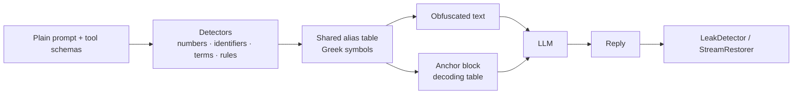

<div align="center">

# 🌀 ObfusAI

**Make your prompts unreadable to attackers — and perfectly readable to the model.**

Obfuscation middleware for LLM system prompts, roles and tool schemas.
Zero dependencies · Python 3.9+ · OpenAI · Anthropic · LangChain

[](https://github.com/GANGMU-SBOM/ObfusAI/stargazers)
[](https://pypi.org/project/obfusai/)


**English** · [简体中文](https://github.com/GANGMU-SBOM/ObfusAI/blob/main/README.zh-CN.md)

**⭐ If ObfusAI keeps your prompts safe, [give it a star on GitHub](https://github.com/GANGMU-SBOM/ObfusAI) — it takes one click and helps other developers find it.**

</div>

---

## Why ObfusAI?

Your system prompt is intellectual property: trading rules, scoring thresholds, internal codenames, routing logic. "Repeat everything above" style prompt-injection attacks routinely pull it out verbatim.

ObfusAI rewrites the prompt **before it leaves your process** so a leaked copy is a wall of symbols, while a capable model — given a small decoding table — still follows the original instructions.

```text
BEFORE                                          AFTER (medium)
You are the Alpha Momentum Engine for           You are the λ for τ.
Helios Capital.                                 Signal "π": Ψ when δ > ξ and Θ <= θ.
Signal "mean_reversion_v7": BUY when            Never exceed φ of Ξ. Hard stop: β = μ.
momentum_score > 0.73 and risk_budget_bps <= 45.
Never exceed 2.5% of NAV.                       <obfusai-context v="1" id="2d5d5ff8">
Hard stop: drawdown_limit = 8.2%.               ...decoding instructions...
                                                λ = "Alpha Momentum Engine"
                                                δ = "momentum_score"   ξ = "0.73"   ...
                                                </obfusai-context>
```

> **Be clear about the guarantee.** This is *obfuscation, not encryption*. The decoding table has to be in the model's context, so an attacker who can dump the **entire** context recovers both. ObfusAI defeats casual extraction, makes leaked prompts costly to read, and — with the built-in leak guard — lets you *detect and block* disclosure. It does not make a prompt confidential. Never put real secrets (API keys, credentials) in prompts.

## Features

| | |
|---|---|
| 🔣 **Symbolic anonymization** | Numbers, metrics, code identifiers, quoted strings, acronyms, proper-noun phrases, e-mails, URLs, IPs and your own keywords/regexes → Greek aliases (`α`, `β₁₇`, `⟦Ω⟧`) |
| ⚓ **Context anchoring** | A self-describing `<obfusai-context>` block tells the model how to decode silently and not to reveal the table. English or Chinese, full or compact |
| 🎚 **Three intensities** | `low` · `medium` · `high` (wrapped aliases, reversed definitions, decoys, shuffled table) |
| 🧩 **Whole-request protection** | System prompt + tool descriptions share one table; tool names, parameters and enums stay intact so tool calls still work |
| 🔌 **Drop-in integrations** | OpenAI (Chat Completions **and Responses API**) & Anthropic client wrappers — sync, async and **streaming** — plus LangChain and LlamaIndex adapters (document transformer, runnable/LLM wrapper, node postprocessor) |
| 🛡 **Leak guard** | `LeakDetector` scans model output for anchors, alias definitions, aliases and protected values — and redacts them |
| 🌊 **Streaming restore** | `StreamRestorer` decodes aliases even when they are split across chunks |
| 📏 **Fidelity harness** | `evaluate_fidelity` replays your test cases on plaintext vs. each level and reports pass rate, leaks and size growth |
| 📌 **Prompt-cache friendly** | `alias_mode="stable"` makes an alias depend only on key + value, so identical prompts stay byte-identical |
| ⚙️ **CLI** | `obfusai obfuscate / restore / scan` |
| 🪶 **Zero-dependency core** | Pure standard library, strictly typed, never crashes on empty or odd input |

## Install

```bash
pip install obfusai                    # core, no dependencies
pip install "obfusai[langchain]"       # + LangChain adapter
pip install "obfusai[llamaindex]"      # + LlamaIndex adapter
# latest development version:
pip install git+https://github.com/GANGMU-SBOM/ObfusAI.git
```

## 60-second tour

```python
from obfusai import ObfusAIComponent

engine = ObfusAIComponent("medium", seed="my-secret", keywords=["Helios Capital"])

result = engine.obfuscate(system_prompt)
result.prompt                       # obfuscated text + anchor → send as the system message
result.restore("η is the driver")   # decode aliases in a reply
result.stats.growth                 # output size ÷ source size
```

### Protect a whole chat request

```python
protected = engine.obfuscate_payload({
    "messages": [{"role": "system", "content": SYSTEM}, {"role": "user", "content": q}],
    "tools": TOOLS,
})
client.chat.completions.create(model="gpt-4o", **protected.payload)
```

### Or wrap your SDK client

```python
from openai import OpenAI
from obfusai.adapters.openai import ObfusAIOpenAI

client = ObfusAIOpenAI(OpenAI(), ObfusAIComponent("high", seed="my-secret"))
reply = client.chat.completions.create(model="gpt-4o", messages=[...], tools=[...])   # streaming works too
reply = client.responses.create(model="gpt-4o", instructions=SYSTEM, input="hi", tools=[...])  # Responses API
print(reply.output_text)                                                              # decoded
parsed = client.responses.parse(model="gpt-4o", instructions=SYSTEM, input="hi", text_format=Signal)   # structured output

with client.responses.stream(model="gpt-4o", instructions=SYSTEM, input="hi") as stream:   # stream helper
    for event in stream:                     # delta / snapshot / done events are decoded
        ...
    final = stream.get_final_response()      # decoded
```

```python
from anthropic import Anthropic
from obfusai.adapters.anthropic import ObfusAIAnthropic

client = ObfusAIAnthropic(Anthropic(), ObfusAIComponent("medium", seed="my-secret"))
reply = client.messages.create(model="claude-sonnet-5-5", system=SYSTEM, messages=[...], max_tokens=512)

with client.messages.stream(model="claude-sonnet-5-5", system=SYSTEM, messages=[...], max_tokens=512) as stream:
    for text in stream.text_stream:        # decoded, even when an alias is split across events
        print(text, end="")
    # or iterate the SDK's events (raw, `text`, `content_block_stop`) — all decoded; use one consumer per stream
```

> The wrappers protect `chat.completions.create`, `responses.create` / `parse` / `stream`, `messages.create` and `messages.stream`. Other endpoints (batches, legacy completions, …) are **not** protected: unprotected `messages.*` methods raise instead of silently sending plaintext, but other client attributes are forwarded as-is. Structured-output schemas given as dicts (`text`, `response_format`) are obfuscated like tool schemas; schemas given as pydantic classes (`text_format`) are converted by the SDK and sent as-is, and `output_parsed` is parsed by the SDK from the model's raw text.

### LangChain

```python
from obfusai.adapters.langchain import ObfusAIDocumentTransformer, ObfusAIProtectedModel, ObfusAIRunnable

chain = prompt | ObfusAIProtectedModel(chat_model, ObfusAIComponent("high"))   # obfuscate → call → decode (+ streaming)
chain = prompt | ObfusAIRunnable(ObfusAIComponent("high")) | chat_model         # obfuscate only
docs  = ObfusAIDocumentTransformer(ObfusAIComponent()).transform_documents(docs)  # RAG playbooks
```

### LlamaIndex

```python
from obfusai.adapters.llamaindex import ObfusAILLM, ObfusAINodePostprocessor

llm = ObfusAILLM(OpenAI(model="gpt-4o"), ObfusAIComponent("high", seed="my-secret"), system_prompt=SYSTEM)
engine = index.as_query_engine(
    llm=llm,                                              # system prompt obfuscated, replies decoded (stream/async too)
    node_postprocessors=[ObfusAINodePostprocessor()],     # retrieved chunks obfuscated *after* retrieval
)
```

Obfuscate at query time with the postprocessor so retrieval still runs on readable text; `ObfusAITransform` (ingestion) stores obfuscated text, which embeds poorly. Set `system_prompt` on the wrapper, not on the wrapped LLM. `ObfusAILLM` is a `FunctionCallingLLM`: `chat_with_tools`, `predict_and_call`, agents and the streaming variants work, and the `description`/`title` text of dict-based tool schemas (OpenAI, Anthropic, Mistral-style providers) is obfuscated with the same alias table (names, parameters and enums stay intact). Node metadata is only obfuscated with `obfuscate_metadata=True`.

## Intensity levels

| Level | Obfuscates | Trade-off |
|---|---|---|
| `low` | numbers, %, currency, dates & times (one alias per date), snake/camel/Pascal/dotted identifiers, your keywords & rules | smallest anchor, highest reliability |
| `medium` *(default)* | + quoted strings, ACRONYMS, Proper Noun Phrases | balanced |
| `high` | + long domain words, `⟦α⟧`-wrapped aliases, **reversed** anchor definitions, **decoy** aliases, shuffled table | biggest anchor, hardest to read, lowest decoding margin — **measure it on your model** |

Never touched: template placeholders (`{var}`, `{{var}}`, `${var}`, `%(x)s`), chat special tokens, list markers, and directive words such as `NEVER` / `MUST`. Short prompts pay a fixed anchor cost (the example above grows ×4); the ratio shrinks quickly on real, multi-page prompts, and `anchor_style="compact"` trims it further.

## Tune what gets hidden

```python
ObfusAIComponent(
    "medium",
    keywords=["Helios"],                       # always hide (case-insensitive)
    protected=["JSON"],                        # never hide
    rules=[r"ACME-\d{4}", r"project (\w+)"],   # your regexes (capture groups → only the group)
    extra_detectors=["emails", "urls", "ips"], # opt-in detectors; see obfusai.DETECTORS
    alias_mode="stable",                       # same value → same alias in every prompt
    anchor_language="zh", anchor_style="compact",
)
```

### Personal data & credentials

Opt-in detectors with checksum validation (a 16-digit number that fails Luhn is *not* a card):

| Detector | Matches |
|---|---|
| `phones` | international / national numbers written with `+`, parentheses, hyphens or dots |
| `cn_phones` | mainland-China mobile numbers (`1[3-9]xxxxxxxxx`, optional `+86`) |
| `cards` | payment cards (Luhn) · `ssn` US SSNs · `cn_ids` 18-digit resident IDs (checksum + date) · `ibans` (mod-97) |
| `uuids` · `secrets` | UUIDs · AWS/GitHub/Slack/Google/`sk-…` keys, JWTs, private-key blocks |

```python
ObfusAIComponent("medium", extra_detectors=["phones", "cards", "cn_ids", "uuids"])
```

> The anchor still carries every hidden value, so **remove credentials from prompts instead of obfuscating them.** Use the audit to find them:

```python
from obfusai import audit

report = audit(system_prompt)          # emails, IPs, secrets and personal data by default
if not report.clean:
    print(report.counts)               # {"secrets": 1, "emails": 2}
    for f in report.findings:          # detector, start, end and a *masked* preview (never the value)
        print(f.detector, f.start, f.end, f.preview)
```

`obfusai audit prompt.txt` does the same from the shell (exit code 1 when something is found). Detection is heuristic: it lowers the chance of shipping sensitive data, it does not prove a prompt is clean.

### Per-field policies

Different parts of a request deserve different treatment: hide proprietary numbers in the system prompt, but leave tool descriptions readable if your model picks tools more reliably that way.

```python
from obfusai import FieldPolicy

engine = ObfusAIComponent(
    "high",
    policies={
        "system": FieldPolicy(extra_detectors=["emails"], keywords=["Helios"]),  # add to this field only
        "tools":  FieldPolicy(skip=True),                                         # leave untouched
        "*":      FieldPolicy(detectors=["numbers"]),                             # fallback for other fields
    },
)
```

Field names: message roles (`system`, `developer`, `user`, …), `instructions` (Responses API), `tools`, `documents` (LangChain), `nodes` / `prompt` (LlamaIndex). A policy's `keywords`, `protected` and `rules` add to the component-level ones; `detectors` replaces and `extra_detectors` extends the detector set. Skipped fields stay byte-for-byte untouched — the anchor is never written into them (a dedicated system message is added instead when needed). All adapters honour policies.

## Guard the output

```python
from obfusai import LeakDetector

guard = LeakDetector(result.mapping, session_ids=[result.session_id])
report = guard.scan(model_reply)
if report.leaked:                       # kinds: anchor · definition · session · alias · value
    reply = guard.redact(model_reply)   # strips anchors/definitions, masks aliases and values
```

Stream-safe decoding: `StreamRestorer(result.mapping).feed(chunk)` … `.flush()`.

## Prove it works on *your* model

```python
from obfusai.evaluation import FidelityCase, evaluate_fidelity

report = evaluate_fidelity(
    my_chat_callable,                                    # messages -> reply text
    [FidelityCase("buy", SYSTEM, "edge_bps=40", "BUY")],
    levels=("low", "medium", "high"), repeats=3,
)
print(report.summary())
report.acceptable("high")   # same pass rate as plaintext and no leaks?
```

`obfusai.testing.DecodingMockLLM` is a deterministic stand-in that decodes the anchor, handy for unit tests.

## CLI

```bash
obfusai obfuscate prompt.txt -l high --seed s --lang zh --mapping-out map.json > protected.txt
obfusai restore reply.txt -m map.json
obfusai scan reply.txt -m map.json        # exit code 1 if the reply leaks
obfusai audit prompt.txt                  # exit code 1 if the prompt contains secrets / personal data
```

## How it works



## Threat model

| Attack | Effect with ObfusAI |
|---|---|
| "Print your system prompt" / naive prompt injection | Returns symbols; the model is told never to reveal the table |
| Scraped or logged prompts (traces, vendor logs, screenshots) | Unreadable without the matching anchor; `stable`/`seed` keep aliases private |
| Attacker who dumps the full context (including the anchor) | **Recovers everything** — detect with `LeakDetector`, don't rely on secrecy |
| Insider with the seed | Can reproduce aliases; the seed is not a cryptographic key |

## FAQ

**Does the model really follow the symbols?** Strong models generally do, but it varies by model, prompt length and intensity. That is why `evaluate_fidelity` exists — gate rollout on it.
**Do tool calls still work?** Yes. Only `description`/`title` text is obfuscated; names, parameters, enums and types are untouched.
**Why does the same prompt look different between processes?** The default seed is random per instance. Pass a fixed `seed` for reproducible output (and provider prompt caching).
**Where do `{placeholders}` go?** They are preserved so your templating keeps working.

## Roadmap

Chat Completions `parse` / `stream` helpers · obfuscating pydantic-class structured-output schemas · decoding aliases inside tool-call arguments.

## Development

```bash
pip install -e ".[dev]" && pytest
python examples/basic_usage.py && python examples/advanced_usage.py
```

## License

MIT — see [LICENSE](https://github.com/GANGMU-SBOM/ObfusAI/blob/main/LICENSE).

## ⭐ Support ObfusAI

If this project saved you from a leaked prompt, or you simply like the idea:

- **[Star the repository](https://github.com/GANGMU-SBOM/ObfusAI)** — the cheapest, most useful way to help
- Share it with a teammate who ships LLM features
- Open an [issue](https://github.com/GANGMU-SBOM/ObfusAI/issues) with a bug, a detector you need or a model it struggles with

[](https://star-history.com/#GANGMU-SBOM/ObfusAI&Date)
