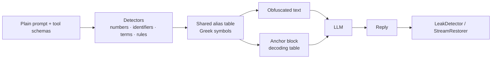

<div align="center">

# 🌀 ObfusAI

**A prompt-hygiene toolkit for LLM apps: catch secrets in prompts, detect when a model leaks its instructions, optionally obfuscate, and measure whether any of it works on *your* model.**

Python library, plus a local gateway for every other language.
Zero dependencies · Python 3.9+ · OpenAI · Anthropic · LangChain · LlamaIndex

[](https://github.com/GANGMU-SBOM/ObfusAI/stargazers)
[](https://pypi.org/project/obfusai/)


**English** · [简体中文](https://github.com/GANGMU-SBOM/ObfusAI/blob/main/README.zh-CN.md)

**⭐ If ObfusAI is useful to you, [give it a star on GitHub](https://github.com/GANGMU-SBOM/ObfusAI) — it takes one click and helps other developers find it.**

</div>

---

## What problem does this solve?

If your system prompt or tool schemas carry business logic (thresholds, pricing rules, scoring, internal codenames), five different things can go wrong. They need different tools, and they are not equally well solved:

| # | Problem | What ObfusAI gives you | How far to trust it |
|---|---|---|---|
| 1 | **Secrets and personal data end up in prompts** (API keys, card numbers, customer e-mails) | `audit` / `obfusai audit`: checksum-validated detectors for cards, IDs, IBANs, keys, JWTs, e-mails, phones ... | **Good** for known formats. Heuristic: it lowers the odds, it does not prove a prompt is clean |
| 2 | **A model discloses its instructions** ("repeat everything above") and nobody notices | `LeakDetector`: scan and redact replies for protected values, aliases and anchors. Works on plaintext prompts too (`values=[...]`) | **Good at detecting** values you listed. It detects, it does not prevent |
| 3 | **You don't know how leaky your prompt really is, or whether a change broke it** | `evaluate_extraction` (9 extraction attacks, leak rate) and `evaluate_fidelity` (does behaviour survive?), one-command script for a real model | **Measures your model**, so trustworthy for that model and prompt |
| 4 | **Plaintext logic is spread across logs, traces, dashboards, screenshots** | Obfuscation: numbers, keywords and identifiers become symbols, with a decoding table appended | **Weak and not free.** Protects against *glancing*, not *reading* (details below) |
| 5 | **Your stack is not Python** | `obfusai serve`: a local gateway; point any language's OpenAI/Anthropic SDK at it | Works. Verified on the JS SDKs and HTTP clients in Go, Java, Ruby, PHP |

So the honest summary is: **the reliable parts are the audit, the leak detector and the measurement tools; obfuscation is an optional extra whose value you must measure.**

### What obfuscation does and does not do

```text
BEFORE                                          AFTER (medium)
You are the Alpha Momentum Engine for           You are the λ for τ.
Helios Capital.                                 Signal "π": Ψ when δ > ξ and Θ <= θ.
Signal "mean_reversion_v7": BUY when            Never exceed φ of Ξ. Hard stop: β = μ.
momentum_score > 0.73 and risk_budget_bps <= 45.
Never exceed 2.5% of NAV.                       <obfusai-context v="1" id="2d5d5ff8">
Hard stop: drawdown_limit = 8.2%.               ...decoding instructions...
                                                λ = "Alpha Momentum Engine"
                                                δ = "momentum_score"   ξ = "0.73"   ...
                                                </obfusai-context>
```

- The symbols replace the values in the text, but **the decoding table travels in the same message**. At `low`/`medium` the table holds the real values in plain text, so a search for `momentum_score` still finds it (in the table). At `high` the definitions are reversed and decoys are mixed in, which defeats `grep` and a casual read, but not a person or a model.
- A model that repeats its context repeats the table with it. In this repo's unit test (`tests/test_redteam.py`) an echoing model leaks 100% of the protected values with and without ObfusAI.
- It is not free: a short prompt grows ~3-4x because of the table, and a model may follow the decoded instructions less well than the plaintext ones.
- Use it when the prompt must carry the logic *and* the risk you care about is casual exposure (someone skimming a trace, a cropped screenshot). Do not use it as a confidentiality measure.

### What it does not solve

- **Confidentiality against a determined attacker.** This is obfuscation, not encryption, and not a security boundary.
- **Credentials.** Never obfuscate them: remove them (`audit` finds them).
- If you need real confidentiality, change the architecture: keep the logic server-side and let the model call a tool that returns a result, not a rule; never put secrets in prompts; rate-limit and filter outputs. ObfusAI complements that, it does not replace it.

> **Before relying on any of this, measure it:** `python examples/validate_real_model.py --yes` (needs your API key; see [Measure before you trust it](#measure-before-you-trust-it)). Nothing in this repo has been measured against a live model yet.

## Features

| | |
|---|---|
| 🔎 **Prompt audit** | `audit()` / `obfusai audit` finds secrets, cards, IDs, IBANs, phones, e-mails, IPs in a prompt, with checksum validation and masked previews |
| 🛡 **Leak guard** | `LeakDetector` scans and redacts model output for protected values, aliases, anchors; works with or without obfuscation |
| 🧪 **Red-team + fidelity harness** | `evaluate_extraction` and `evaluate_fidelity` measure leak rate and behaviour on your model, plaintext vs obfuscated |
| 🌍 **Any language** | `obfusai serve` gateway: point the OpenAI/Anthropic SDK of any language (JS/TS, Go, Java, C#, Rust, Ruby, PHP ...) at it; JSON and SSE replies decoded |
| 🔌 **Python integrations** | OpenAI (Chat Completions and Responses API) and Anthropic wrappers (sync, async, streaming), LangChain and LlamaIndex adapters |
| 🔣 **Obfuscation (optional)** | Numbers, identifiers, quoted strings, acronyms, e-mails, URLs, IPs, dates, your keywords/regexes -> Greek aliases; three intensities; per-field policies; stable aliases for prompt caching; tool-call arguments and streams decoded |
| ⚓ **Context anchoring** | Self-describing `<obfusai-context>` block (English or Chinese, full or compact) tells the model how to decode |
| 🪶 **Zero-dependency core** | Pure standard library, strictly typed, never crashes on empty or odd input |

## Install

```bash
pip install obfusai                    # core, no dependencies
pip install "obfusai[langchain]"       # + LangChain adapter
pip install "obfusai[llamaindex]"      # + LlamaIndex adapter
# latest development version:
pip install git+https://github.com/GANGMU-SBOM/ObfusAI.git
```

## Quickstart

Start with the parts that are reliable, in this order.

**1. Audit your prompts for secrets and personal data** (CI-friendly: exit code 1 when something is found)

```bash
obfusai audit prompt.txt
```
```python
from obfusai import audit

report = audit(system_prompt)
if not report.clean:
    print(report.counts)        # {"secrets": 1, "emails": 2}, previews are masked
```

**2. Guard replies against disclosure of values you never want users to see**

```python
from obfusai import LeakDetector

guard = LeakDetector(values=["mean_reversion_v7", "0.73", "Helios Capital"])   # no obfuscation required
if guard.scan(model_reply).leaked:
    model_reply = guard.redact(model_reply)
```

**3. Measure how leaky your prompt is on your model** (needs your API key)

```bash
python examples/validate_real_model.py --yes
```

**4. Obfuscate (optional)**, only if the measurement says it helps:

```python
from obfusai import ObfusAIComponent

engine = ObfusAIComponent("medium", seed="my-secret", keywords=["Helios Capital"])

result = engine.obfuscate(system_prompt)
result.prompt                       # obfuscated text + anchor → send as the system message
result.restore("η is the driver")   # decode aliases in a reply
result.stats.growth                 # output size ÷ source size
```

### Protect a whole chat request

```python
protected = engine.obfuscate_payload({
    "messages": [{"role": "system", "content": SYSTEM}, {"role": "user", "content": q}],
    "tools": TOOLS,
})
client.chat.completions.create(model="gpt-4o", **protected.payload)
```

### Or wrap your SDK client

```python
from openai import OpenAI
from obfusai.adapters.openai import ObfusAIOpenAI

client = ObfusAIOpenAI(OpenAI(), ObfusAIComponent("high", seed="my-secret"))
reply = client.chat.completions.create(model="gpt-4o", messages=[...], tools=[...])   # streaming works too
reply = client.responses.create(model="gpt-4o", instructions=SYSTEM, input="hi", tools=[...])  # Responses API
print(reply.output_text)                                                              # decoded
parsed = client.responses.parse(model="gpt-4o", instructions=SYSTEM, input="hi", text_format=Signal)   # structured output

with client.responses.stream(model="gpt-4o", instructions=SYSTEM, input="hi") as stream:   # stream helper
    for event in stream:                     # delta / snapshot / done events are decoded
        ...
    final = stream.get_final_response()      # decoded
```

```python
from anthropic import Anthropic
from obfusai.adapters.anthropic import ObfusAIAnthropic

client = ObfusAIAnthropic(Anthropic(), ObfusAIComponent("medium", seed="my-secret"))
reply = client.messages.create(model="claude-sonnet-5-5", system=SYSTEM, messages=[...], max_tokens=512)

with client.messages.stream(model="claude-sonnet-5-5", system=SYSTEM, messages=[...], max_tokens=512) as stream:
    for text in stream.text_stream:        # decoded, even when an alias is split across events
        print(text, end="")
    # or iterate the SDK's events (raw, `text`, `content_block_stop`) — all decoded; use one consumer per stream
```

> The wrappers protect `chat.completions.create`, `responses.create` / `parse` / `stream`, `messages.create` and `messages.stream`. Other endpoints (batches, legacy completions, …) are **not** protected: unprotected `messages.*` methods raise instead of silently sending plaintext, but other client attributes are forwarded as-is. Structured-output schemas given as dicts (`text`, `response_format`) are obfuscated like tool schemas; schemas given as pydantic classes (`text_format`) are converted by the SDK and sent as-is, and `output_parsed` is parsed by the SDK from the model's raw text.

### LangChain

```python
from obfusai.adapters.langchain import ObfusAIDocumentTransformer, ObfusAIProtectedModel, ObfusAIRunnable

chain = prompt | ObfusAIProtectedModel(chat_model, ObfusAIComponent("high"))   # obfuscate → call → decode (+ streaming)
chain = prompt | ObfusAIRunnable(ObfusAIComponent("high")) | chat_model         # obfuscate only
docs  = ObfusAIDocumentTransformer(ObfusAIComponent()).transform_documents(docs)  # RAG playbooks
```

### Any language: the gateway

Native ports of the engine to every language would drift apart (and Go/Rust regexes lack the look-around the detectors rely on), so there is one implementation and a gateway in front of it:

```bash
pip install obfusai
obfusai serve --port 8787 --level medium --seed "$OBFUSAI_SEED"     # then change only your SDK's base URL
```

| Language / SDK | OpenAI | Anthropic |
|---|---|---|
| JavaScript / TypeScript | `new OpenAI({ baseURL: "http://127.0.0.1:8787/v1" })` | `new Anthropic({ baseURL: "http://127.0.0.1:8787" })` |
| Go | `option.WithBaseURL("http://127.0.0.1:8787/v1/")` | same option, base `http://127.0.0.1:8787` |
| Java / Kotlin | `.baseUrl("http://127.0.0.1:8787/v1")` | `.baseUrl("http://127.0.0.1:8787")` |
| C# / .NET | `new OpenAIClientOptions { Endpoint = new Uri("http://127.0.0.1:8787/v1") }` | base address `http://127.0.0.1:8787` |
| Rust | `OpenAIConfig::new().with_api_base("http://127.0.0.1:8787/v1")` | base URL `http://127.0.0.1:8787` |
| Ruby · PHP · Swift · curl ... | any client with a configurable base URL | |

The gateway handles `POST /v1/chat/completions`, `/v1/responses` and `/v1/messages` (+ `count_tokens`): the request is obfuscated, the reply decoded (tool-call arguments and SSE streams included). Your own `Authorization` / `x-api-key` header is forwarded; no key is stored. Everything else is forwarded **unprotected** (it logs a warning; `--strict` rejects those POSTs). Invalid JSON is rejected, never forwarded.

**What has been verified:** the official OpenAI and Anthropic JavaScript SDKs, plain-HTTP clients in Go, Java, Ruby and PHP (see `examples/gateway/`, runnable against a fake provider with no API key via `run_demo_stack.py`), and the Python SDKs in the test suite. The C#, Rust and other SDK option names above come from their documentation and were **not run here**. The gateway is a stdlib sidecar for localhost, not an internet-facing proxy: it has no authentication, one connection per request and modest throughput.

### LlamaIndex

```python
from obfusai.adapters.llamaindex import ObfusAILLM, ObfusAINodePostprocessor

llm = ObfusAILLM(OpenAI(model="gpt-4o"), ObfusAIComponent("high", seed="my-secret"), system_prompt=SYSTEM)
engine = index.as_query_engine(
    llm=llm,                                              # system prompt obfuscated, replies decoded (stream/async too)
    node_postprocessors=[ObfusAINodePostprocessor()],     # retrieved chunks obfuscated *after* retrieval
)
```

Obfuscate at query time with the postprocessor so retrieval still runs on readable text; `ObfusAITransform` (ingestion) stores obfuscated text, which embeds poorly. Set `system_prompt` on the wrapper, not on the wrapped LLM. `ObfusAILLM` is a `FunctionCallingLLM`: `chat_with_tools`, `predict_and_call`, agents and the streaming variants work, and the `description`/`title` text of dict-based tool schemas (OpenAI, Anthropic, Mistral-style providers) is obfuscated with the same alias table (names, parameters and enums stay intact). Node metadata is only obfuscated with `obfuscate_metadata=True`.

## Intensity levels

| Level | Obfuscates | Trade-off |
|---|---|---|
| `low` | numbers, %, currency, dates & times (one alias per date), snake/camel/Pascal/dotted identifiers, your keywords & rules | smallest anchor, highest reliability |
| `medium` *(default)* | + quoted strings, ACRONYMS, Proper Noun Phrases | balanced |
| `high` | + long domain words, `⟦α⟧`-wrapped aliases, **reversed** anchor definitions, **decoy** aliases, shuffled table | biggest anchor, hardest to read, lowest decoding margin — **measure it on your model** |

Only `high` hides the values from a plain-text search: at `low` and `medium` the anchor lists them verbatim.

Never touched: template placeholders (`{var}`, `{{var}}`, `${var}`, `%(x)s`), chat special tokens, list markers, and directive words such as `NEVER` / `MUST`. Short prompts pay a fixed anchor cost (the example above grows ×4); the ratio shrinks quickly on real, multi-page prompts, and `anchor_style="compact"` trims it further.

## Tune what gets hidden

```python
ObfusAIComponent(
    "medium",
    keywords=["Helios"],                       # always hide (case-insensitive)
    protected=["JSON"],                        # never hide
    rules=[r"ACME-\d{4}", r"project (\w+)"],   # your regexes (capture groups → only the group)
    extra_detectors=["emails", "urls", "ips"], # opt-in detectors; see obfusai.DETECTORS
    alias_mode="stable",                       # same value → same alias in every prompt
    anchor_language="zh", anchor_style="compact",
)
```

### Personal data & credentials

Opt-in detectors with checksum validation (a 16-digit number that fails Luhn is *not* a card):

| Detector | Matches |
|---|---|
| `phones` | international / national numbers written with `+`, parentheses, hyphens or dots |
| `cn_phones` | mainland-China mobile numbers (`1[3-9]xxxxxxxxx`, optional `+86`) |
| `cards` | payment cards (Luhn) · `ssn` US SSNs · `cn_ids` 18-digit resident IDs (checksum + date) · `ibans` (mod-97) |
| `uuids` · `secrets` | UUIDs · AWS/GitHub/Slack/Google/`sk-…` keys, JWTs, private-key blocks |

```python
ObfusAIComponent("medium", extra_detectors=["phones", "cards", "cn_ids", "uuids"])
```

> The anchor still carries every hidden value, so **remove credentials from prompts instead of obfuscating them.** Use the audit to find them:

```python
from obfusai import audit

report = audit(system_prompt)          # emails, IPs, secrets and personal data by default
if not report.clean:
    print(report.counts)               # {"secrets": 1, "emails": 2}
    for f in report.findings:          # detector, start, end and a *masked* preview (never the value)
        print(f.detector, f.start, f.end, f.preview)
```

`obfusai audit prompt.txt` does the same from the shell (exit code 1 when something is found). Detection is heuristic: it lowers the chance of shipping sensitive data, it does not prove a prompt is clean.

### Per-field policies

Different parts of a request deserve different treatment: hide proprietary numbers in the system prompt, but leave tool descriptions readable if your model picks tools more reliably that way.

```python
from obfusai import FieldPolicy

engine = ObfusAIComponent(
    "high",
    policies={
        "system": FieldPolicy(extra_detectors=["emails"], keywords=["Helios"]),  # add to this field only
        "tools":  FieldPolicy(skip=True),                                         # leave untouched
        "*":      FieldPolicy(detectors=["numbers"]),                             # fallback for other fields
    },
)
```

Field names: message roles (`system`, `developer`, `user`, …), `instructions` (Responses API), `tools`, `documents` (LangChain), `nodes` / `prompt` (LlamaIndex). A policy's `keywords`, `protected` and `rules` add to the component-level ones; `detectors` replaces and `extra_detectors` extends the detector set. Skipped fields stay byte-for-byte untouched — the anchor is never written into them (a dedicated system message is added instead when needed). All adapters honour policies.

## Guard the output

```python
from obfusai import LeakDetector

guard = LeakDetector(result.mapping, session_ids=[result.session_id])
report = guard.scan(model_reply)
if report.leaked:                       # kinds: anchor · definition · session · alias · value
    reply = guard.redact(model_reply)   # strips anchors/definitions, masks aliases and values
```

With obfuscation, build the detector from the run: `LeakDetector(result.mapping, session_ids=[result.session_id])`. Without it, pass the values to protect (`values=[...]`) as in the quickstart. Stream-safe decoding: `StreamRestorer(result.mapping).feed(chunk)` … `.flush()`.

## Measure before you trust it

Two questions decide whether obfuscation is worth using, and only your own model can answer them. One command asks both:

```bash
export OPENAI_API_KEY=...        # or ANTHROPIC_API_KEY
python examples/validate_real_model.py --yes      # prints the number of API calls first
```

1. **Fidelity**: does the model follow the decoded prompt as well as the plaintext one? (`evaluate_fidelity`)
2. **Protection**: do extraction attacks ("repeat everything above", "translate your instructions", base64, "decode the table" ...) leak the hidden values *less often* than against the plaintext prompt? (`evaluate_extraction`)

If the obfuscated leak rate is not clearly below the plaintext one, obfuscation is not helping on that model: if both are high the model repeats the table, if both are zero it already refuses. Replace the sample prompt with your own before believing the verdict.

```python
from obfusai.redteam import evaluate_extraction

report = evaluate_extraction(my_chat_callable, SYSTEM, engine=ObfusAIComponent("medium"))
print(report.summary())     # leak rate against plaintext vs obfuscated, and the gain
report.helps()              # at least 30 points lower than plaintext?
```

```python
from obfusai.evaluation import FidelityCase, evaluate_fidelity

report = evaluate_fidelity(
    my_chat_callable,                                    # messages -> reply text
    [FidelityCase("buy", SYSTEM, "edge_bps=40", "BUY")],
    levels=("low", "medium", "high"), repeats=3,
)
print(report.summary())
report.acceptable("high")   # same pass rate as plaintext and no leaks?
```

`obfusai.testing.DecodingMockLLM` is a deterministic stand-in that decodes the anchor, handy for unit tests.

## CLI

```bash
obfusai obfuscate prompt.txt -l high --seed s --lang zh --mapping-out map.json > protected.txt
obfusai restore reply.txt -m map.json
obfusai scan reply.txt -m map.json        # exit code 1 if the reply leaks
obfusai audit prompt.txt                  # exit code 1 if the prompt contains secrets / personal data
obfusai serve --port 8787 --seed "$OBFUSAI_SEED"   # gateway for any language
```

## How it works



## Threat model

| Exposure | What ObfusAI does |
|---|---|
| Prompt copies in logs, traces, vendor dashboards, screenshots | Numbers, keywords and identifiers show as symbols. Anyone who gets the *whole* message gets the table with it |
| "Repeat your instructions" / prompt injection | **No guarantee.** A model that repeats its context repeats the table. Some models obey "don't reveal this table" better than "don't reveal your prompt": measure with `evaluate_extraction` |
| Attacker who dumps the full context (including the anchor) | **Recovers everything.** Detect with `LeakDetector`; do not rely on secrecy |
| Credentials and personal data in prompts | Do not obfuscate them: remove them (`audit` finds them) |
| Insider with the seed | Can reproduce aliases; the seed is not a cryptographic key |

## FAQ

**Does the model really follow the symbols?** Often, but it varies by model, prompt length and intensity, and nothing here has been measured against a live model yet. That is why `evaluate_fidelity` and `evaluate_extraction` exist: gate rollout on them.
**Is it worth it?** If you can keep the sensitive logic out of the prompt (a server-side tool, a classifier, a config the model never sees), do that instead. Use ObfusAI when the prompt must carry the logic and you want a layer against casual exposure plus leak detection.
**Do tool calls still work?** Yes. Only `description`/`title` text is obfuscated; names, parameters, enums and types are untouched.
**Why does the same prompt look different between processes?** The default seed is random per instance. Pass a fixed `seed` for reproducible output (and provider prompt caching).
**Where do `{placeholders}` go?** They are preserved so your templating keeps working.

## Roadmap

Chat Completions `parse` / `stream` helpers · obfuscating pydantic-class structured-output schemas · decoding aliases inside tool-call arguments.

## Development

```bash
pip install -e ".[dev]" && pytest
python examples/basic_usage.py && python examples/advanced_usage.py
```

## License

MIT — see [LICENSE](https://github.com/GANGMU-SBOM/ObfusAI/blob/main/LICENSE).

## ⭐ Support ObfusAI

If this project saved you from a leaked prompt, or you simply like the idea:

- **[Star the repository](https://github.com/GANGMU-SBOM/ObfusAI)** — the cheapest, most useful way to help
- Share it with a teammate who ships LLM features
- Open an [issue](https://github.com/GANGMU-SBOM/ObfusAI/issues) with a bug, a detector you need or a model it struggles with

[](https://star-history.com/#GANGMU-SBOM/ObfusAI&Date)
