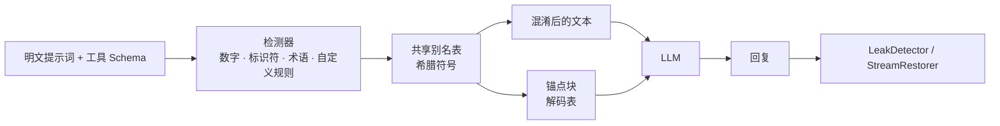

<div align="center">

# 🌀 ObfusAI

**让泄露出去的提示词难以阅读——并实测它在*你的*模型上是否真的有效。**

面向 LLM 提示词、工具 Schema 与日志的混淆和泄露检测工具包，任何语言都可以通过本地网关使用。
核心零依赖 · Python 3.9+ · 支持 OpenAI · Anthropic · LangChain · LlamaIndex

[](https://github.com/GANGMU-SBOM/ObfusAI/stargazers)
[](https://pypi.org/project/obfusai/)


[English](README.md) · **简体中文**

**⭐ 如果 ObfusAI 对你有用，请[在 GitHub 上点个 Star](https://github.com/GANGMU-SBOM/ObfusAI)——只需一次点击，却能让更多开发者发现它。**

</div>

---

## 为什么需要 ObfusAI？

系统提示词是你的核心资产：交易规则、评分阈值、内部代号、路由逻辑……明文提示词会出现在日志、链路追踪、供应商后台、截图和 Bug 报告里，“把上面的内容原样重复一遍”这类攻击也能把它们从模型里套出来。

ObfusAI 在提示词**离开你的进程之前**就对其改写：这些副本里看到的是符号而不是你的数字和关键词；而强大的模型只要拿到一张小小的解码表，仍有可能按原意执行。

```text
混淆前                                           混淆后（medium）
You are the Alpha Momentum Engine for           You are the λ for τ.
Helios Capital.                                 Signal "π": Ψ when δ > ξ and Θ <= θ.
Signal "mean_reversion_v7": BUY when            Never exceed φ of Ξ. Hard stop: β = μ.
momentum_score > 0.73 and risk_budget_bps <= 45.
Never exceed 2.5% of NAV.                       <obfusai-context v="1" id="2d5d5ff8">
Hard stop: drawdown_limit = 8.2%.               ……解码说明……
                                                λ = "Alpha Momentum Engine"
                                                δ = "momentum_score"   ξ = "0.73"   ……
                                                </obfusai-context>
```

> **请先读这段：它是什么，不是什么。**
>
> - 它是“混淆”，不是“加密”，更**不是安全边界**。解码表和符号在同一个上下文里，任何能让模型吐出上下文的手段都会同时吐出两者：会“原样重复上面所有内容”的模型也会把解码表一起重复。仓库里的单元测试（`tests/test_redteam.py`）就展示了这一点：回显型模型无论用不用 ObfusAI，受保护的值都 100% 泄露。
> - 它可能有帮助的地方：落进日志、链路追踪、后台和截图里的提示词与工具 Schema 副本；grep 式的批量抓取；对“不要泄露这张表”比对“不要泄露你的提示词”更听话的模型。与混淆无关，泄露检测和提示词审计本身能抓出真实的失误。
> - **有没有帮助取决于你的模型和提示词，而且可能损失准确率、增加 Token**（短提示词会因解码表膨胀约 3～4 倍）。不要想当然：先[实测](#上线前先实测)。
> - 真正有效的防线：别把机密和业务逻辑写进提示词（改成调用服务端工具），永远别把凭证写进去，并过滤输出。

## 功能一览

| | |
|---|---|
| 🔣 **符号匿名化** | 把数字、指标、代码标识符、引号内字符串、缩写、专有名词短语、邮箱、URL、IP 以及你自定义的关键词/正则，映射为希腊字母别名（`α`、`β₁₇`、`⟦Ω⟧`） |
| ⚓ **上下文锚定** | 自带 `<obfusai-context>` 说明块，指导模型静默解码，并禁止泄露该表。支持中文/英文、完整/精简两种写法 |
| 🎚 **三档强度** | `low` · `medium` · `high`（高档含包裹式别名、逆序定义、诱饵别名、乱序表） |
| 🧩 **整个请求一起保护** | 系统提示词与工具描述共用一张别名表；工具名、参数名、枚举值保持不变，工具调用照常工作 |
| 🔌 **即插即用** | OpenAI（Chat Completions **与 Responses API**）和 Anthropic 客户端包装器——同步、异步、**流式**全支持——以及 LangChain 与 LlamaIndex 适配器（文档转换器、Runnable/LLM 包装器、节点后处理器） |
| 🛡 **泄露防护** | `LeakDetector` 扫描模型输出中的锚点、别名定义、别名与受保护原值，并可一键脱敏 |
| 🌊 **流式还原** | `StreamRestorer` 即使别名被切在两个数据块之间也能正确还原 |
| 📏 **保真度评测** | `evaluate_fidelity` 在明文与各档位上回放你的测试用例，给出通过率、泄露率与体积膨胀 |
| 📌 **兼容提示词缓存** | `alias_mode="stable"` 让别名只取决于密钥与原值，相同提示词输出逐字节一致 |
| 🌍 **任何语言** | `obfusai serve` 是本地网关：把**任意**语言（JS/TS、Go、Java、C#、Rust、Ruby、PHP……）的 OpenAI/Anthropic SDK 指向它，提示词即被保护、回复自动还原，流式也支持 |
| 🧪 **红队评测** | `evaluate_extraction` 用提示词套取攻击同时攻击明文和混淆后的提示词，告诉你混淆在你的模型上是否真的降低了泄露率 |
| ⚙️ **命令行工具** | `obfusai obfuscate / restore / scan / audit / serve` |
| 🪶 **零依赖核心** | 纯标准库、严格类型标注，遇到空串或怪异输入也不会崩溃 |

## 安装

```bash
pip install obfusai                    # 核心，无任何依赖
pip install "obfusai[langchain]"       # 含 LangChain 适配器
pip install "obfusai[llamaindex]"      # 含 LlamaIndex 适配器
# 安装最新开发版：
pip install git+https://github.com/GANGMU-SBOM/ObfusAI.git
```

## 60 秒上手

```python
from obfusai import ObfusAIComponent

engine = ObfusAIComponent("medium", seed="my-secret", keywords=["Helios Capital"],
                          anchor_language="zh")          # 解码说明用中文

result = engine.obfuscate(system_prompt)
result.prompt                       # 混淆文本 + 锚点，直接作为 system 消息发送
result.restore("η 是主要驱动因素")    # 还原回复里出现的别名
result.stats.growth                 # 输出体积 ÷ 原文体积
```

### 保护完整的对话请求

```python
protected = engine.obfuscate_payload({
    "messages": [{"role": "system", "content": SYSTEM}, {"role": "user", "content": q}],
    "tools": TOOLS,
})
client.chat.completions.create(model="gpt-4o", **protected.payload)
```

### 或者直接包装 SDK 客户端

```python
from openai import OpenAI
from obfusai.adapters.openai import ObfusAIOpenAI

client = ObfusAIOpenAI(OpenAI(), ObfusAIComponent("high", seed="my-secret"))
reply = client.chat.completions.create(model="gpt-4o", messages=[...], tools=[...])   # 流式同样支持
reply = client.responses.create(model="gpt-4o", instructions=SYSTEM, input="hi", tools=[...])  # Responses API
print(reply.output_text)                                                              # 已还原
parsed = client.responses.parse(model="gpt-4o", instructions=SYSTEM, input="hi", text_format=Signal)   # 结构化输出

with client.responses.stream(model="gpt-4o", instructions=SYSTEM, input="hi") as stream:   # 流式辅助
    for event in stream:                     # delta / snapshot / done 事件均已还原
        ...
    final = stream.get_final_response()      # 已还原
```

```python
from anthropic import Anthropic
from obfusai.adapters.anthropic import ObfusAIAnthropic

client = ObfusAIAnthropic(Anthropic(), ObfusAIComponent("medium", seed="my-secret"))
reply = client.messages.create(model="claude-sonnet-5-5", system=SYSTEM, messages=[...], max_tokens=512)

with client.messages.stream(model="claude-sonnet-5-5", system=SYSTEM, messages=[...], max_tokens=512) as stream:
    for text in stream.text_stream:        # 已还原；别名被切在两个事件之间也没问题
        print(text, end="")
    # 也可以直接迭代 SDK 事件（原始事件、`text`、`content_block_stop`），同样已还原；每个流只用一种消费方式
```

> 包装器保护 `chat.completions.create`、`responses.create` / `parse` / `stream`、`messages.create` 与 `messages.stream`。其他接口（批处理、旧版 completions 等）**不受保护**：未受保护的 `messages.*` 方法会直接报错而不是悄悄发出明文，其他客户端属性则原样转发。字典形式的结构化输出 Schema（`text`、`response_format`）会像工具 Schema 一样被混淆；以 pydantic 类给出的 Schema（`text_format`）由 SDK 转换后原样发送，`output_parsed` 由 SDK 根据模型的原始文本解析。

### LangChain

```python
from obfusai.adapters.langchain import ObfusAIDocumentTransformer, ObfusAIProtectedModel, ObfusAIRunnable

chain = prompt | ObfusAIProtectedModel(chat_model, ObfusAIComponent("high"))   # 混淆 → 调用 → 还原（含流式）
chain = prompt | ObfusAIRunnable(ObfusAIComponent("high")) | chat_model         # 仅混淆
docs  = ObfusAIDocumentTransformer(ObfusAIComponent()).transform_documents(docs)  # 保护 RAG 里的内部手册
```

### 任何语言：网关

把引擎移植到每一种语言，各个版本迟早会各走各路（Go/Rust 的正则还不支持检测器依赖的环视），所以只保留一份实现，并在前面放一个网关：

```bash
pip install obfusai
obfusai serve --port 8787 --level medium --seed "$OBFUSAI_SEED"     # 然后只改 SDK 的 base URL
```

| 语言 / SDK | OpenAI | Anthropic |
|---|---|---|
| JavaScript / TypeScript | `new OpenAI({ baseURL: "http://127.0.0.1:8787/v1" })` | `new Anthropic({ baseURL: "http://127.0.0.1:8787" })` |
| Go | `option.WithBaseURL("http://127.0.0.1:8787/v1/")` | 同一选项，地址 `http://127.0.0.1:8787` |
| Java / Kotlin | `.baseUrl("http://127.0.0.1:8787/v1")` | `.baseUrl("http://127.0.0.1:8787")` |
| C# / .NET | `new OpenAIClientOptions { Endpoint = new Uri("http://127.0.0.1:8787/v1") }` | 基础地址 `http://127.0.0.1:8787` |
| Rust | `OpenAIConfig::new().with_api_base("http://127.0.0.1:8787/v1")` | 基础地址 `http://127.0.0.1:8787` |
| Ruby · PHP · Swift · curl …… | 任何可配置 base URL 的客户端 | |

网关处理 `POST /v1/chat/completions`、`/v1/responses` 和 `/v1/messages`（含 `count_tokens`）：请求被混淆，回复被还原（工具调用参数和 SSE 流式都包括）。转发的是你自己的 `Authorization` / `x-api-key` 头，网关不保存任何密钥。其他接口会被**不加保护地**原样转发（会打印警告；`--strict` 会直接拒绝这类 POST）。非法 JSON 会被拒绝，绝不转发。

**已验证的范围：** 官方 OpenAI 与 Anthropic 的 JavaScript SDK，Go、Java、Ruby、PHP 的纯 HTTP 客户端（见 `examples/gateway/`，用 `run_demo_stack.py` 无需 API Key 即可对着假的供应商运行），以及测试套件里的 Python SDK。上表中 C#、Rust 等其他 SDK 的选项名来自它们的文档，**没有在这里运行过**。网关是面向 localhost 的标准库 sidecar，不是面向公网的代理：没有认证、每个请求一条连接、吞吐一般。

### LlamaIndex

```python
from obfusai.adapters.llamaindex import ObfusAILLM, ObfusAINodePostprocessor

llm = ObfusAILLM(OpenAI(model="gpt-4o"), ObfusAIComponent("high", seed="my-secret"), system_prompt=SYSTEM)
engine = index.as_query_engine(
    llm=llm,                                              # 系统提示词被混淆，回复自动还原（流式/异步同样支持）
    node_postprocessors=[ObfusAINodePostprocessor()],     # 检索到的片段在检索*之后*再混淆
)
```

建议在查询阶段用后处理器混淆，这样检索仍然基于可读文本；`ObfusAITransform`（入库阶段）会把混淆后的文本存进索引，向量检索效果会变差。请把 `system_prompt` 设在包装器上，而不是被包装的 LLM 上。`ObfusAILLM` 本身就是 `FunctionCallingLLM`：`chat_with_tools`、`predict_and_call`、Agent 以及各流式变体都能用，字典形式的工具 Schema（OpenAI、Anthropic、Mistral 类提供商）里的 `description` / `title` 文本会与系统提示词共用同一张别名表被混淆（名称、参数、枚举保持不变）。节点元数据只有在 `obfuscate_metadata=True` 时才会被混淆。

## 三档强度

| 档位 | 混淆内容 | 取舍 |
|---|---|---|
| `low` | 数字、百分比、货币、日期与时间（一个日期只生成一个别名）、snake/camel/Pascal/点号标识符、自定义关键词与规则 | 锚点最小，可靠性最高 |
| `medium`（默认） | + 引号内字符串、ACRONYM 缩写、Proper Noun 专有名词短语 | 均衡 |
| `high` | + 领域长词、`⟦α⟧` 包裹式别名、**逆序**锚点定义、**诱饵**别名、乱序表 | 锚点最大、最难读，模型解码余量最小——**务必在你的模型上实测** |

始终保持原样：模板占位符（`{var}`、`{{var}}`、`${var}`、`%(x)s`）、聊天特殊标记、列表序号，以及 `NEVER` / `MUST` 这类指令性词汇。短提示词要承担固定的锚点开销（上面的例子体积约 ×4）；真实的多页提示词里这个比例会迅速下降，`anchor_style="compact"` 还可进一步压缩。

## 精细控制要隐藏什么

```python
ObfusAIComponent(
    "medium",
    keywords=["Helios"],                       # 一律隐藏（不区分大小写）
    protected=["JSON"],                        # 一律不隐藏
    rules=[r"ACME-\d{4}", r"project (\w+)"],   # 自定义正则（带捕获组时只替换捕获组）
    extra_detectors=["emails", "urls", "ips"], # 可选检测器，见 obfusai.DETECTORS
    alias_mode="stable",                       # 相同原值 → 在所有提示词里得到相同别名
    anchor_language="zh", anchor_style="compact",
)
```

### 个人信息与凭证

可选的检测器，带校验位验证（过不了 Luhn 校验的 16 位数字*不会*被当成银行卡）：

| 检测器 | 匹配内容 |
|---|---|
| `phones` | 带 `+`、括号、连字符或点号的国际/国内号码 |
| `cn_phones` | 中国大陆手机号（`1[3-9]xxxxxxxxx`，可带 `+86`） |
| `cards` | 银行卡（Luhn）· `ssn` 美国社保号 · `cn_ids` 18 位居民身份证（校验位+出生日期）· `ibans`（mod-97） |
| `uuids` · `secrets` | UUID · AWS/GitHub/Slack/Google/`sk-…` 密钥、JWT、私钥块 |

```python
ObfusAIComponent("medium", extra_detectors=["phones", "cards", "cn_ids", "uuids"])
```

> 锚点里仍然带着每一个被隐藏的值，所以**凭证应当直接从提示词里删除，而不是混淆。** 用审计功能把它们找出来：

```python
from obfusai import audit

report = audit(system_prompt)          # 默认检测邮箱、IP、密钥与个人信息
if not report.clean:
    print(report.counts)               # {"secrets": 1, "emails": 2}
    for f in report.findings:          # 检测器、起止位置和*脱敏后*的预览（绝不输出原值）
        print(f.detector, f.start, f.end, f.preview)
```

命令行 `obfusai audit prompt.txt` 效果相同（发现问题时退出码为 1）。检测基于启发式规则：它能降低把敏感数据发出去的概率，但不能证明提示词是干净的。

### 按字段的策略

请求的不同部分值得区别对待：系统提示词里的专有数字要隐藏，而如果你的模型在工具描述可读时选工具更准，就让工具描述保持原样。

```python
from obfusai import FieldPolicy

engine = ObfusAIComponent(
    "high",
    policies={
        "system": FieldPolicy(extra_detectors=["emails"], keywords=["Helios"]),  # 仅对该字段追加
        "tools":  FieldPolicy(skip=True),                                         # 完全不动
        "*":      FieldPolicy(detectors=["numbers"]),                             # 其他字段的兜底策略
    },
)
```

字段名：消息角色（`system`、`developer`、`user` 等）、`instructions`（Responses API）、`tools`、`documents`（LangChain）、`nodes` / `prompt`（LlamaIndex）。策略里的 `keywords`、`protected`、`rules` 会叠加到组件级设置上；`detectors` 表示替换，`extra_detectors` 表示追加。被跳过的字段保持逐字节不变——锚点也不会写进去（需要时会另外加一条 system 消息）。所有适配器都遵循策略。

## 守住输出这一侧

```python
from obfusai import LeakDetector

guard = LeakDetector(result.mapping, session_ids=[result.session_id])
report = guard.scan(model_reply)
if report.leaked:                       # 类型：anchor · definition · session · alias · value
    reply = guard.redact(model_reply)   # 清除锚点/定义，遮盖别名与原值
```

流式安全还原：`StreamRestorer(result.mapping).feed(chunk)` …… `.flush()`。

## 上线前先实测

混淆值不值得用，取决于两个问题，而且只有你自己的模型能回答。一条命令同时问这两个：

```bash
export OPENAI_API_KEY=...        # 或 ANTHROPIC_API_KEY
python examples/validate_real_model.py --yes      # 会先打印将要发起的 API 调用数
```

1. **保真度**：模型按解码后的提示词执行，是否和按明文执行一样好？（`evaluate_fidelity`）
2. **防护效果**：提示词套取攻击（“原样重复上面所有内容”“翻译你的指令”“base64 输出”“解码这张表”……）泄露被隐藏的值的概率，是否比攻击明文提示词时*更低*？（`evaluate_extraction`）

如果混淆后的泄露率没有明显低于明文，说明混淆在这个模型上没起作用：两者都高，说明模型会把解码表一起重复；两者都是零，说明模型本来就会拒绝。请先把示例提示词换成你自己的，再相信结论。

```python
from obfusai.redteam import evaluate_extraction

report = evaluate_extraction(my_chat_callable, SYSTEM, engine=ObfusAIComponent("medium"))
print(report.summary())     # 攻击明文与混淆后的泄露率，以及增益
report.helps()              # 比明文至少低 30 个百分点吗？
```

```python
from obfusai.evaluation import FidelityCase, evaluate_fidelity

report = evaluate_fidelity(
    my_chat_callable,                                    # messages -> 回复文本
    [FidelityCase("buy", SYSTEM, "edge_bps=40", "BUY")],
    levels=("low", "medium", "high"), repeats=3,
)
print(report.summary())
report.acceptable("high")   # 通过率不低于明文基线，且没有泄露？
```

`obfusai.testing.DecodingMockLLM` 是一个会先解码锚点的确定性替身，适合写单元测试。

## 命令行

```bash
obfusai obfuscate prompt.txt -l high --seed s --lang zh --mapping-out map.json > protected.txt
obfusai restore reply.txt -m map.json
obfusai scan reply.txt -m map.json        # 回复存在泄露时退出码为 1
obfusai audit prompt.txt                  # 提示词含密钥/个人信息时退出码为 1
obfusai serve --port 8787 --seed "$OBFUSAI_SEED"   # 面向任何语言的网关
```

## 工作原理



## 威胁模型

| 暴露面 | ObfusAI 做了什么 |
|---|---|
| 日志、链路追踪、供应商后台、截图里的提示词副本 | 数字、关键词、标识符显示为符号。但拿到*整条*消息的人会连解码表一起拿到 |
| “重复你的指令” / 提示词注入 | **没有保证。** 会重复上下文的模型也会重复解码表。有些模型对“不要泄露这张表”比对“不要泄露你的提示词”更听话：请用 `evaluate_extraction` 实测 |
| 能导出完整上下文（含锚点）的攻击者 | **全部还原。** 用 `LeakDetector` 检测，不要依赖保密 |
| 提示词里的凭证和个人信息 | 不要混淆，直接删掉（`audit` 能找出来） |
| 掌握 seed 的内部人员 | 可复现别名；seed 并不是密码学意义上的密钥 |

## 常见问题

**模型真的会按符号执行吗？** 常常可以，但会因模型、提示词长度与强度而异，而且这里还没有用真实模型实测过。所以才提供 `evaluate_fidelity` 和 `evaluate_extraction`——请用它们作为上线门槛。
**值得用吗？** 如果你能把敏感逻辑挪出提示词（服务端工具、分类器、模型看不到的配置），就那样做。只有当提示词必须承载逻辑，而你想要一层针对随意暴露的防护外加泄露检测时，才用 ObfusAI。
**工具调用还能用吗？** 能。只混淆 `description` / `title` 文本，名称、参数、枚举与类型原样保留。
**为什么不同进程里同一个提示词长得不一样？** 默认 seed 每个实例随机。传入固定的 `seed` 即可得到可复现的输出（也便于利用供应商的提示词缓存）。
**`{占位符}` 会怎样？** 它们会被保留，你的模板渲染不受影响。

## 路线图

Chat Completions 的 `parse` / `stream` 辅助方法 · 混淆以 pydantic 类给出的结构化输出 Schema · 还原工具调用参数里的别名。

## 开发

```bash
pip install -e ".[dev]" && pytest
python examples/basic_usage.py && python examples/advanced_usage.py
```

## 许可证

MIT — 详见 [LICENSE](LICENSE)。

## ⭐ 支持 ObfusAI

如果这个项目帮你避免了一次提示词泄露，或者你只是喜欢这个想法：

- **[给仓库点个 Star](https://github.com/GANGMU-SBOM/ObfusAI)**——成本最低、帮助最大的支持方式
- 把它分享给正在上线 LLM 功能的同事
- 提个 [Issue](https://github.com/GANGMU-SBOM/ObfusAI/issues)：反馈 Bug、你需要的检测器，或它在哪个模型上表现不佳

[](https://star-history.com/#GANGMU-SBOM/ObfusAI&Date)
