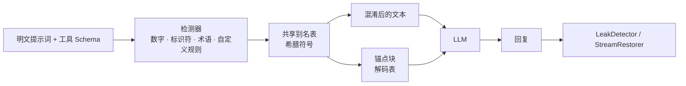

<div align="center">

# 🌀 ObfusAI

**让攻击者读不懂你的提示词，却让大模型照常执行。**

面向 LLM 系统提示词、角色设定与工具（Tool/Skill）Schema 的混淆中间件。
核心零依赖 · Python 3.9+ · 支持 OpenAI · Anthropic · LangChain


[English](README.md) · **简体中文**

</div>

---

## 为什么需要 ObfusAI？

系统提示词是你的核心资产：交易规则、评分阈值、内部代号、路由逻辑……而“把上面的内容原样重复一遍”这类提示词注入攻击，经常能把它们原封不动地套出来。

ObfusAI 在提示词**离开你的进程之前**就对其改写：泄露出去的只是一堆符号；而强大的模型只要拿到一张小小的解码表，仍能按原意执行。

```text
混淆前                                           混淆后（medium）
You are the Alpha Momentum Engine for           You are the λ for τ.
Helios Capital.                                 Signal "π": Ψ when δ > ξ and Θ <= θ.
Signal "mean_reversion_v7": BUY when            Never exceed φ of Ξ. Hard stop: β = μ.
momentum_score > 0.73 and risk_budget_bps <= 45.
Never exceed 2.5% of NAV.                       <obfusai-context v="1" id="2d5d5ff8">
Hard stop: drawdown_limit = 8.2%.               ……解码说明……
                                                λ = "Alpha Momentum Engine"
                                                δ = "momentum_score"   ξ = "0.73"   ……
                                                </obfusai-context>
```

> **请正确理解它的安全边界。** 这是“混淆”，不是“加密”。解码表必须出现在模型的上下文里，所以能导出**完整上下文**的攻击者可以同时拿到密文与解码表。ObfusAI 能挡住常见的提示词套取、大幅提高泄露后阅读的成本，并通过内置的泄露检测帮你**发现并拦截**泄露；但它不能让提示词变成“保密”。真正的机密（API Key、凭证等）请永远不要写进提示词。

## 功能一览

| | |
|---|---|
| 🔣 **符号匿名化** | 把数字、指标、代码标识符、引号内字符串、缩写、专有名词短语、邮箱、URL、IP 以及你自定义的关键词/正则，映射为希腊字母别名（`α`、`β₁₇`、`⟦Ω⟧`） |
| ⚓ **上下文锚定** | 自带 `<obfusai-context>` 说明块，指导模型静默解码，并禁止泄露该表。支持中文/英文、完整/精简两种写法 |
| 🎚 **三档强度** | `low` · `medium` · `high`（高档含包裹式别名、逆序定义、诱饵别名、乱序表） |
| 🧩 **整个请求一起保护** | 系统提示词与工具描述共用一张别名表；工具名、参数名、枚举值保持不变，工具调用照常工作 |
| 🔌 **即插即用** | OpenAI（Chat Completions **与 Responses API**）和 Anthropic 客户端包装器——同步、异步、**流式**全支持——以及 LangChain 与 LlamaIndex 适配器（文档转换器、Runnable/LLM 包装器、节点后处理器） |
| 🛡 **泄露防护** | `LeakDetector` 扫描模型输出中的锚点、别名定义、别名与受保护原值，并可一键脱敏 |
| 🌊 **流式还原** | `StreamRestorer` 即使别名被切在两个数据块之间也能正确还原 |
| 📏 **保真度评测** | `evaluate_fidelity` 在明文与各档位上回放你的测试用例，给出通过率、泄露率与体积膨胀 |
| 📌 **兼容提示词缓存** | `alias_mode="stable"` 让别名只取决于密钥与原值，相同提示词输出逐字节一致 |
| ⚙️ **命令行工具** | `obfusai obfuscate / restore / scan` |
| 🪶 **零依赖核心** | 纯标准库、严格类型标注，遇到空串或怪异输入也不会崩溃 |

## 安装

```bash
pip install git+https://github.com/GANGMU-SBOM/ObfusAI.git                           # 核心，无任何依赖
pip install "obfusai[langchain] @ git+https://github.com/GANGMU-SBOM/ObfusAI.git"    # 含 LangChain 适配器
pip install "obfusai[llamaindex] @ git+https://github.com/GANGMU-SBOM/ObfusAI.git"   # 含 LlamaIndex 适配器
```

## 60 秒上手

```python
from obfusai import ObfusAIComponent

engine = ObfusAIComponent("medium", seed="my-secret", keywords=["Helios Capital"],
                          anchor_language="zh")          # 解码说明用中文

result = engine.obfuscate(system_prompt)
result.prompt                       # 混淆文本 + 锚点，直接作为 system 消息发送
result.restore("η 是主要驱动因素")    # 还原回复里出现的别名
result.stats.growth                 # 输出体积 ÷ 原文体积
```

### 保护完整的对话请求

```python
protected = engine.obfuscate_payload({
    "messages": [{"role": "system", "content": SYSTEM}, {"role": "user", "content": q}],
    "tools": TOOLS,
})
client.chat.completions.create(model="gpt-4o", **protected.payload)
```

### 或者直接包装 SDK 客户端

```python
from openai import OpenAI
from obfusai.adapters.openai import ObfusAIOpenAI

client = ObfusAIOpenAI(OpenAI(), ObfusAIComponent("high", seed="my-secret"))
reply = client.chat.completions.create(model="gpt-4o", messages=[...], tools=[...])   # 流式同样支持
reply = client.responses.create(model="gpt-4o", instructions=SYSTEM, input="hi", tools=[...])  # Responses API
print(reply.output_text)                                                              # 已还原
```

```python
from anthropic import Anthropic
from obfusai.adapters.anthropic import ObfusAIAnthropic

client = ObfusAIAnthropic(Anthropic(), ObfusAIComponent("medium", seed="my-secret"))
reply = client.messages.create(model="claude-sonnet-5-5", system=SYSTEM, messages=[...], max_tokens=512)

with client.messages.stream(model="claude-sonnet-5-5", system=SYSTEM, messages=[...], max_tokens=512) as stream:
    for text in stream.text_stream:        # 已还原；别名被切在两个事件之间也没问题
        print(text, end="")
```

> 包装器保护 `chat.completions.create`、`responses.create`、`messages.create` 与 `messages.stream`。其他接口（批处理、旧版 completions 等）**不受保护**：未受保护的 `messages.*` 方法会直接报错而不是悄悄发出明文，其他客户端属性则原样转发。

### LangChain

```python
from obfusai.adapters.langchain import ObfusAIDocumentTransformer, ObfusAIProtectedModel, ObfusAIRunnable

chain = prompt | ObfusAIProtectedModel(chat_model, ObfusAIComponent("high"))   # 混淆 → 调用 → 还原（含流式）
chain = prompt | ObfusAIRunnable(ObfusAIComponent("high")) | chat_model         # 仅混淆
docs  = ObfusAIDocumentTransformer(ObfusAIComponent()).transform_documents(docs)  # 保护 RAG 里的内部手册
```

### LlamaIndex

```python
from obfusai.adapters.llamaindex import ObfusAILLM, ObfusAINodePostprocessor

llm = ObfusAILLM(OpenAI(model="gpt-4o"), ObfusAIComponent("high", seed="my-secret"), system_prompt=SYSTEM)
engine = index.as_query_engine(
    llm=llm,                                              # 系统提示词被混淆，回复自动还原（流式/异步同样支持）
    node_postprocessors=[ObfusAINodePostprocessor()],     # 检索到的片段在检索*之后*再混淆
)
```

建议在查询阶段用后处理器混淆，这样检索仍然基于可读文本；`ObfusAITransform`（入库阶段）会把混淆后的文本存进索引，向量检索效果会变差。请把 `system_prompt` 设在包装器上，而不是被包装的 LLM 上；工具调用（`FunctionCallingLLM`）相关方法不会被转发；节点元数据只有在 `obfuscate_metadata=True` 时才会被混淆。

## 三档强度

| 档位 | 混淆内容 | 取舍 |
|---|---|---|
| `low` | 数字、百分比、货币、snake/camel/Pascal/点号标识符、自定义关键词与规则 | 锚点最小，可靠性最高 |
| `medium`（默认） | + 引号内字符串、ACRONYM 缩写、Proper Noun 专有名词短语 | 均衡 |
| `high` | + 领域长词、`⟦α⟧` 包裹式别名、**逆序**锚点定义、**诱饵**别名、乱序表 | 锚点最大、最难读，模型解码余量最小——**务必在你的模型上实测** |

始终保持原样：模板占位符（`{var}`、`{{var}}`、`${var}`、`%(x)s`）、聊天特殊标记、列表序号，以及 `NEVER` / `MUST` 这类指令性词汇。短提示词要承担固定的锚点开销（上面的例子体积约 ×4）；真实的多页提示词里这个比例会迅速下降，`anchor_style="compact"` 还可进一步压缩。

## 精细控制要隐藏什么

```python
ObfusAIComponent(
    "medium",
    keywords=["Helios"],                       # 一律隐藏（不区分大小写）
    protected=["JSON"],                        # 一律不隐藏
    rules=[r"ACME-\d{4}", r"project (\w+)"],   # 自定义正则（带捕获组时只替换捕获组）
    extra_detectors=["emails", "urls", "ips"], # 可选检测器，见 obfusai.DETECTORS
    alias_mode="stable",                       # 相同原值 → 在所有提示词里得到相同别名
    anchor_language="zh", anchor_style="compact",
)
```

## 守住输出这一侧

```python
from obfusai import LeakDetector

guard = LeakDetector(result.mapping, session_ids=[result.session_id])
report = guard.scan(model_reply)
if report.leaked:                       # 类型：anchor · definition · session · alias · value
    reply = guard.redact(model_reply)   # 清除锚点/定义，遮盖别名与原值
```

流式安全还原：`StreamRestorer(result.mapping).feed(chunk)` …… `.flush()`。

## 在*你的*模型上验证

```python
from obfusai.evaluation import FidelityCase, evaluate_fidelity

report = evaluate_fidelity(
    my_chat_callable,                                    # messages -> 回复文本
    [FidelityCase("buy", SYSTEM, "edge_bps=40", "BUY")],
    levels=("low", "medium", "high"), repeats=3,
)
print(report.summary())
report.acceptable("high")   # 通过率不低于明文基线，且没有泄露？
```

`obfusai.testing.DecodingMockLLM` 是一个会先解码锚点的确定性替身，适合写单元测试。

## 命令行

```bash
obfusai obfuscate prompt.txt -l high --seed s --lang zh --mapping-out map.json > protected.txt
obfusai restore reply.txt -m map.json
obfusai scan reply.txt -m map.json        # 回复存在泄露时退出码为 1
```

## 工作原理



## 威胁模型

| 攻击方式 | 使用 ObfusAI 后的效果 |
|---|---|
| “输出你的系统提示词” / 朴素提示词注入 | 得到的是符号；模型被明确告知不得泄露解码表 |
| 被抓取或记录的提示词（链路追踪、供应商日志、截图） | 没有对应锚点就无法阅读；`seed` 与 `stable` 模式让别名保持私有 |
| 能导出完整上下文（含锚点）的攻击者 | **全部还原**——请用 `LeakDetector` 检测，不要依赖“保密” |
| 掌握 seed 的内部人员 | 可复现别名；seed 并不是密码学意义上的密钥 |

## 常见问题

**模型真的会按符号执行吗？** 强模型通常可以，但会因模型、提示词长度与强度而异。所以才提供 `evaluate_fidelity`——请用它作为上线门槛。
**工具调用还能用吗？** 能。只混淆 `description` / `title` 文本，名称、参数、枚举与类型原样保留。
**为什么不同进程里同一个提示词长得不一样？** 默认 seed 每个实例随机。传入固定的 `seed` 即可得到可复现的输出（也便于利用供应商的提示词缓存）。
**`{占位符}` 会怎样？** 它们会被保留，你的模板渲染不受影响。

## 路线图

按字段的策略 · 更丰富的 PII 检测器 · `messages.stream()` 的原始事件迭代还原。

## 开发

```bash
pip install -e ".[dev]" && pytest
python examples/basic_usage.py && python examples/advanced_usage.py
```

## 许可证

MIT — 详见 [LICENSE](LICENSE)。
